# 末日回响 / MoriEchoes

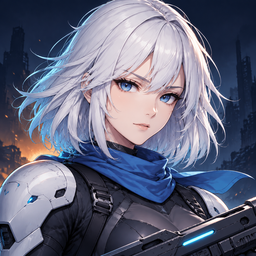

Unity 6000.6.7f1 / C# / URP 2D / Input System 的离线单机横版闯关射击 Roguelite。当前实际配置为 **8 名角色、9 把武器、10 关战役**。前五关横向推进，第六至八关沿既有 Ascent 规则向上推进，第九关海面游泳，第十关水下浮沉；早期向下推进资料保留为历史设计。

- 代码：[GitHub](https://github.com/onyjhgiom/DeltaPact) · [Gitee](https://gitee.com/clt2026/DeltaPact)
- 操作与启动：[HOW_TO_PLAY.md](HOW_TO_PLAY.md)
- Windows x64 试玩包：[Releases/MoriEchoes_20261119_233520](Releases/MoriEchoes_20261119_233520)（含 SHA-256 与启动说明）

## 画面预览

### 主视觉

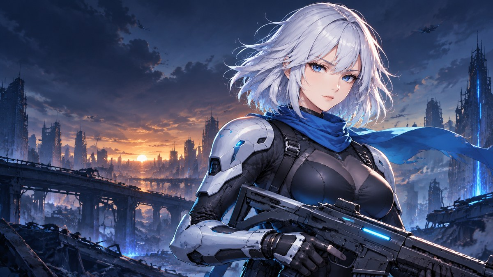

### 实机画面与角色

| Windows Player 实际运行画面（城市废墟 / 寒峰隧道 / 星坠核心井 / 沉没圣堂） | 角色原画与强化形态对比 |
|---|---|
| 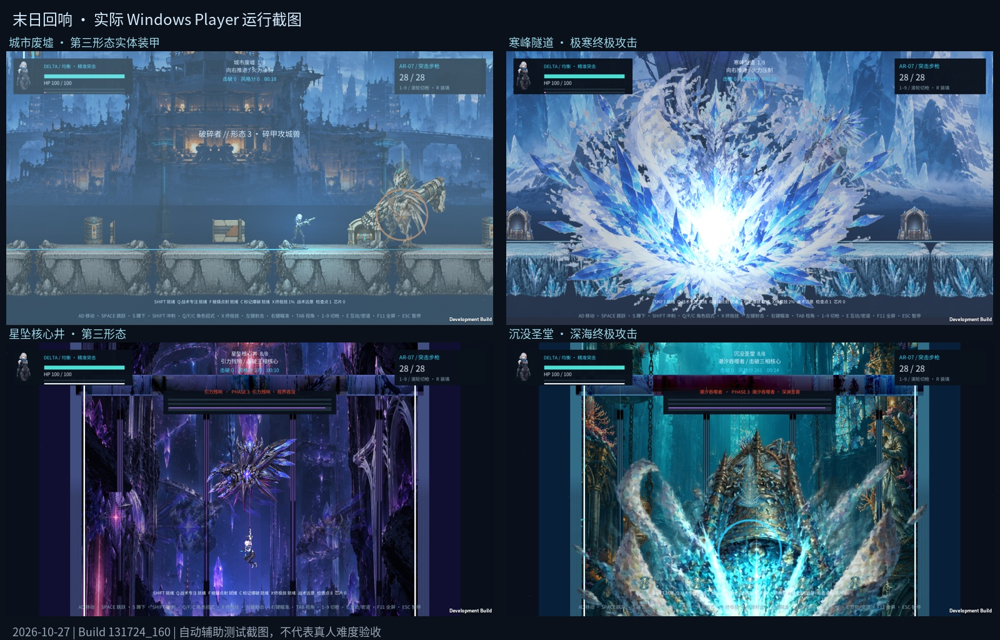 | 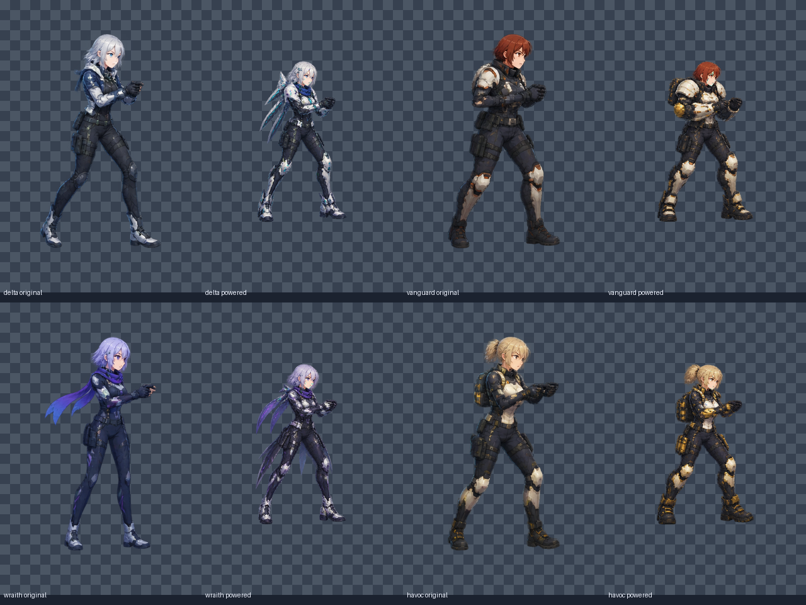 |

| 角色、Boss 与武器素材总览 | 八关 Boss 实体换装与终极特效 |
|---|---|
| 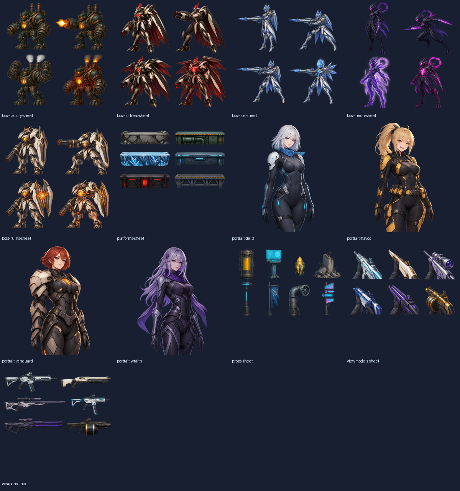 | 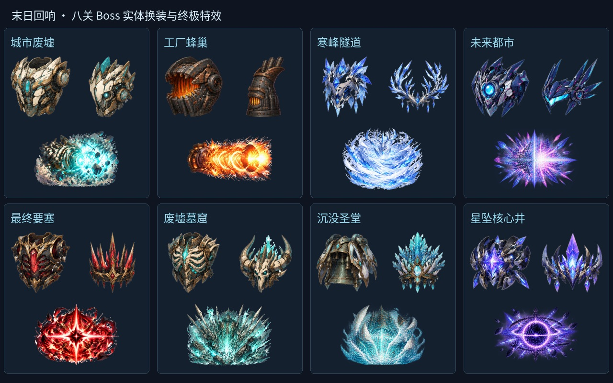 |

### 敌人、技能与新角色

| 五类关卡敌人与打击特效 | Q/F/C 技能光效（DELTA / VANGUARD / WRAITH / HAVOC） |
|---|---|
| 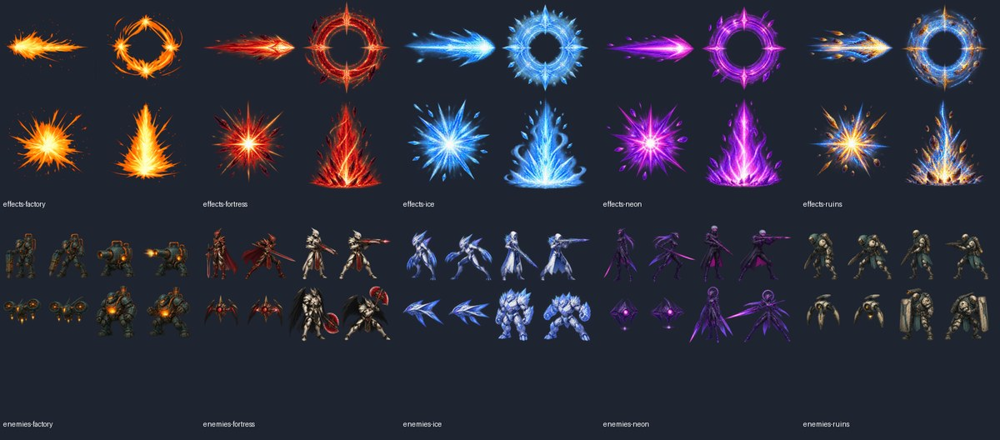 | 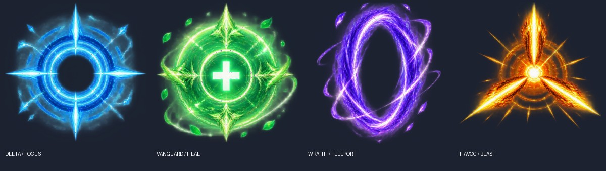 |

后加入的四名角色 KALT / VEIL / SERA / ROOK：

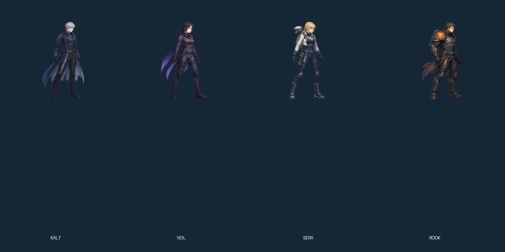

### 关卡材质与扩展内容

前八关平台、墙体和升降梯按各关主材质生成，下图为 Stage 1–8 的 Player 材质对照（点击图片可查看大图）：

  <a href="docs/preview/stage-surfaces-wide.jpg">
    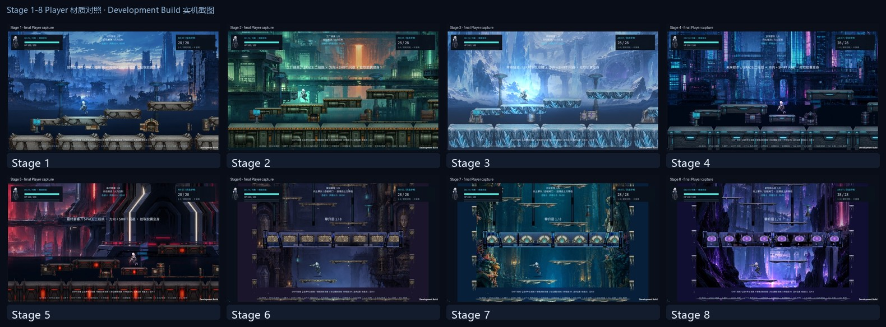
  </a>

查看竖版原图（2×4 排列，分辨率更高）

  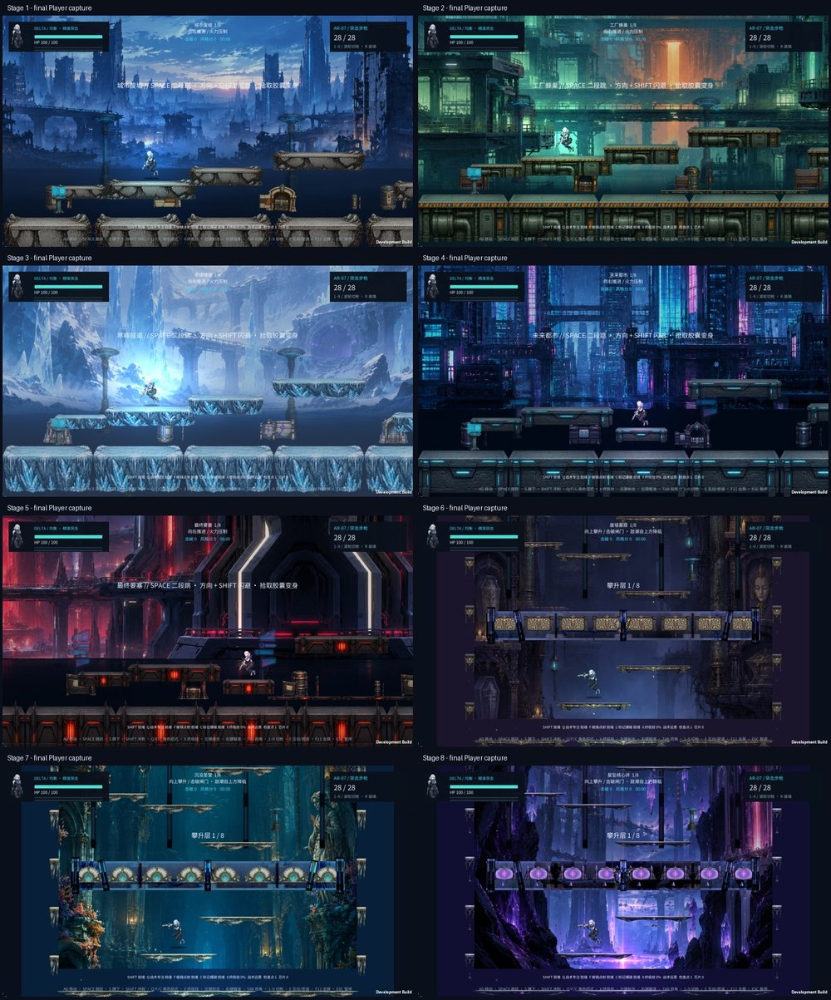

展开：水关美术素材总览（第九关海面 / 第十关水下，按素材索引顺序分上下两图）

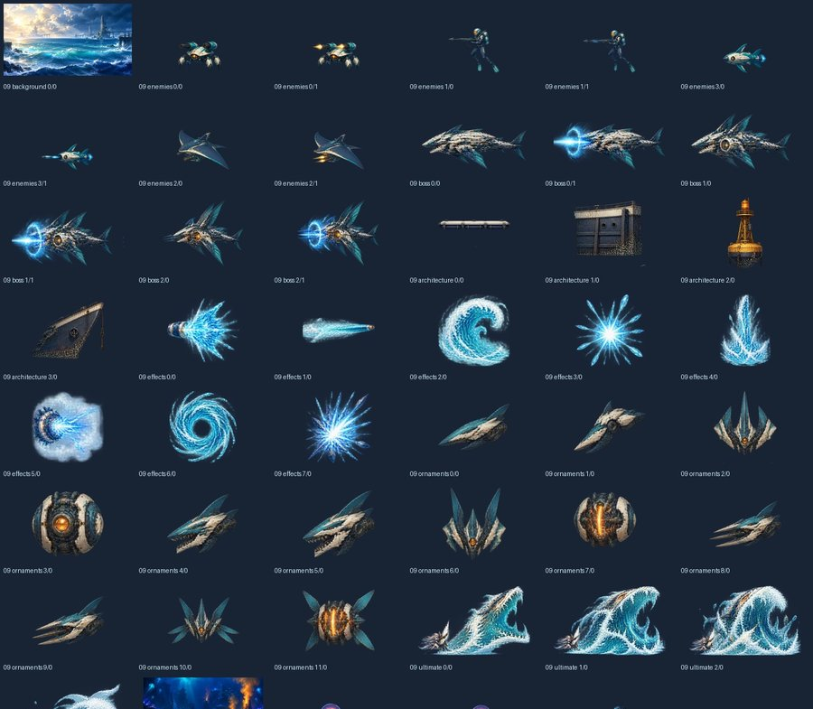

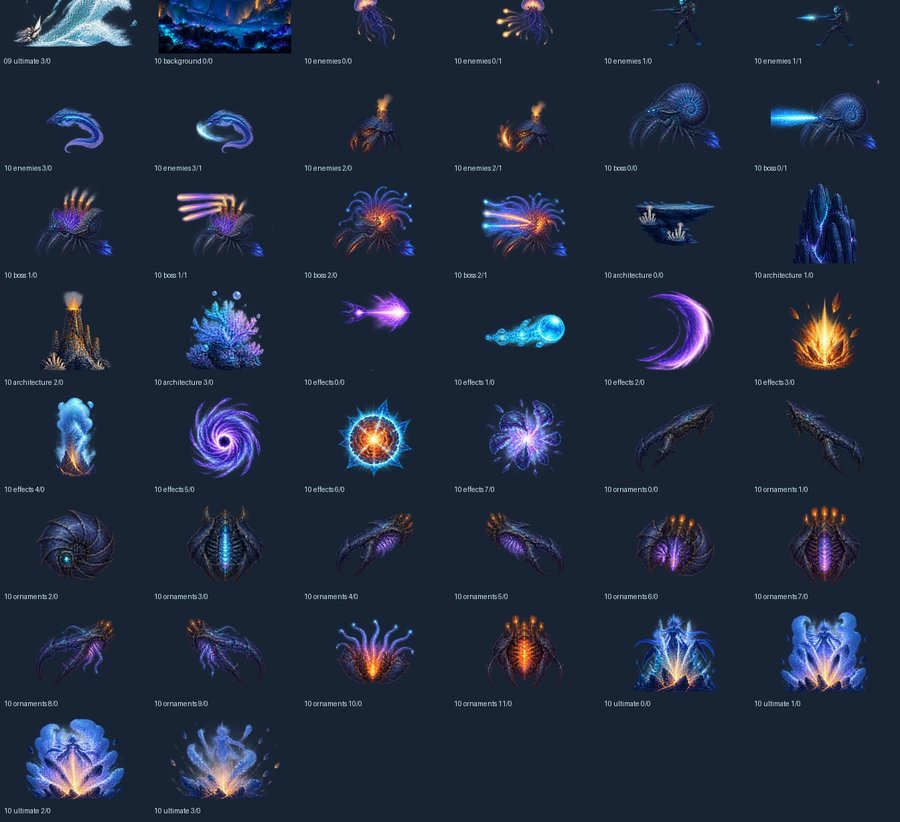

展开：十关 Boss 各 3 招技能素材总览（随三个形态逐步解锁）

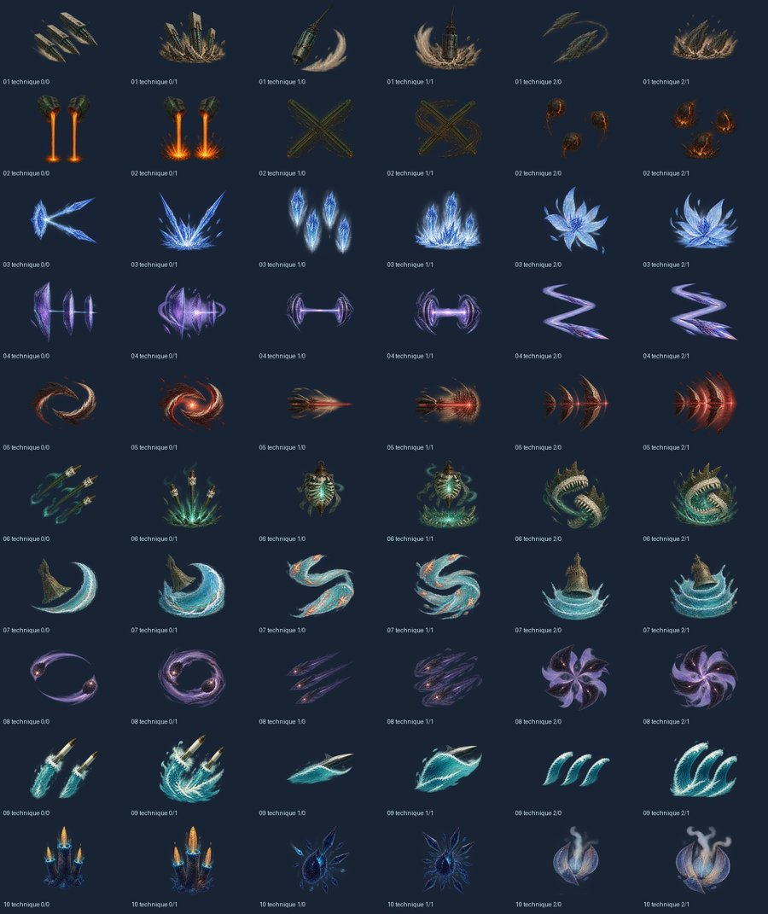

### 预览图来源

| 预览图 | 工程内来源 |
|---|---|
| 主视觉 / 图标 | `output/imagegen/game-promo-20261120/`、`output/imagegen/game-icon-20261119/` |
| 实机画面 | `ArtProduction/boss-ascension-v2/runtime-preview.jpg` |
| 角色与强化形态 | `ArtProduction/combat-polish-v1/previews/identity-comparison.png` |
| 角色、Boss 与武器总览 | `ArtProduction/arsenal-v2/originals-preview.png` |
| Boss 换装与终极特效 | `ArtProduction/boss-ascension-v2/boss-ascension-preview.jpg` |
| 敌人与打击特效 | `ArtProduction/encounter-v3/originals-preview.png` |
| 技能光效 | `ArtProduction/skills-v1/contact-sheet.png` |
| 新角色原画 | `ArtProduction/descent-premium-v1/review/new-roster.png` |
| 场景材质对照（横版 / 竖版） | `Validation/FeedbackTraversal_20261027_Delivery/stage-surfaces-review.jpg`，横向版由同一原图重排 |
| 水关素材 | `Assets/Art/Production/SwimAnimeV2/review.jpg` |
| Boss 技能素材 | `Assets/Art/Production/BossTechniquesV1/review.jpg` |
| 十关场景与小怪 | `AnimeV1/Backgrounds/`、`PremiumV1/Backgrounds/`、`PremiumV1/Enemies/`、`SwimAnimeV2/stage-09|10/` |

> 以上图片来自工程内 `ArtProduction/`、`output/imagegen/` 与验收预览，均为开发版实拍或生成稿，不代表商业最终美术。完整素材索引见 [`Releases/MoriEchoes_素材库_20261120_000432`](Releases/MoriEchoes_素材库_20261120_000432)。

## 十关场景与小怪

每关的背景与小怪均取自工程内已绑定的正式素材，按关卡顺序拼成下图；右侧为该关小怪精灵，关卡名称与推进方式标注在场景图下方。

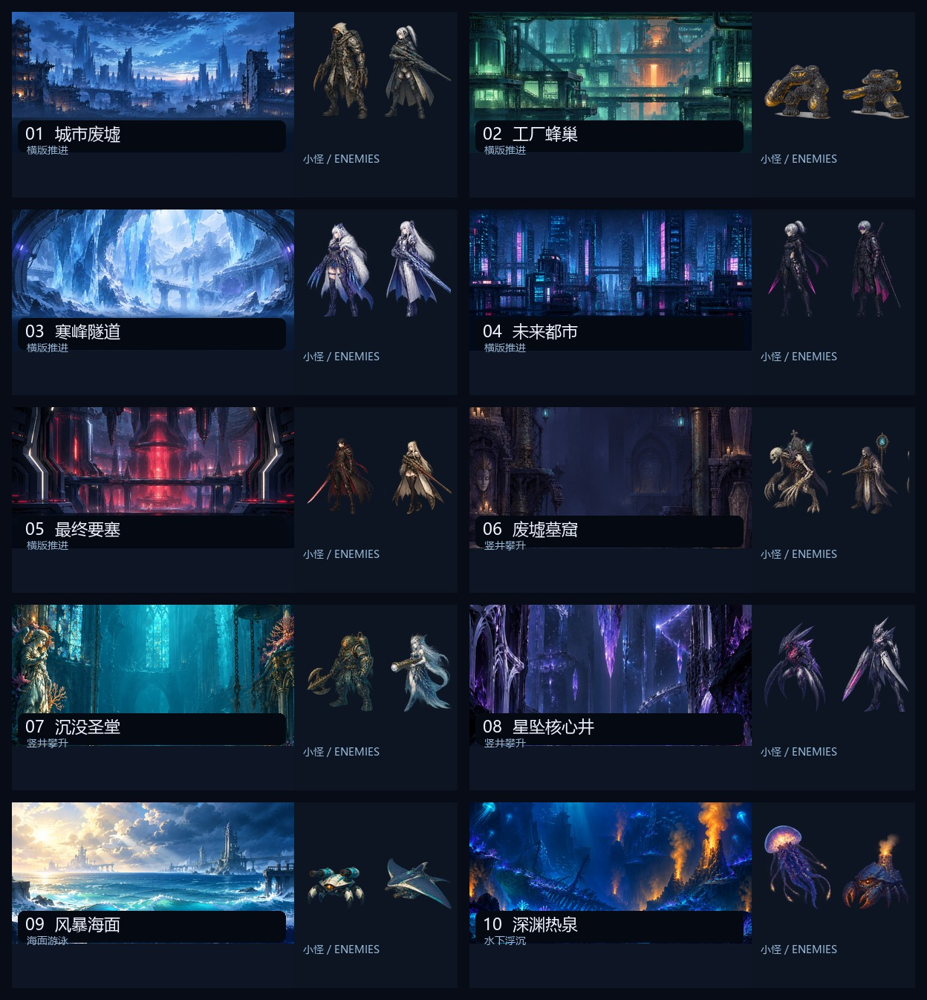

| 关卡 | 名称 | 推进方式 | 背景素材 | 小怪素材 |
|---|---|---|---|---|
| 01 | 城市废墟 | 横版推进 | `AnimeV1/Backgrounds/ruins.png` | `PremiumV1/Enemies/ruins-*` |
| 02 | 工厂蜂巢 | 横版推进 | `AnimeV1/Backgrounds/factory.png` | `PremiumV1/Enemies/factory-*` |
| 03 | 寒峰隧道 | 横版推进 | `AnimeV1/Backgrounds/ice.png` | `PremiumV1/Enemies/ice-*` |
| 04 | 未来都市 | 横版推进 | `AnimeV1/Backgrounds/neon.png` | `PremiumV1/Enemies/neon-*` |
| 05 | 最终要塞 | 横版推进 | `AnimeV1/Backgrounds/fortress.png` | `PremiumV1/Enemies/fortress-*` |
| 06 | 废墟墓窟 | 竖井攀升 | `PremiumV1/Backgrounds/tomb.png` | `PremiumV1/Enemies/tomb-*` |
| 07 | 沉没圣堂 | 竖井攀升 | `PremiumV1/Backgrounds/tide.png` | `PremiumV1/Enemies/tide-*` |
| 08 | 星坠核心井 | 竖井攀升 | `PremiumV1/Backgrounds/rift.png` | `PremiumV1/Enemies/rift-*` |
| 09 | 风暴海面 | 海面游泳 | `SwimAnimeV2/stage-09/background.png` | `SwimAnimeV2/stage-09/enemies-*` |
| 10 | 深渊热泉 | 水下浮沉 | `SwimAnimeV2/stage-10/background.png` | `SwimAnimeV2/stage-10/enemies-*` |

> 表中路径省略 `Assets/Art/Production/` 前缀；第 6–8 关的竖井场景沿用本关主地面材质，第 9–10 关使用水关专属生成素材。

## 快速开始

双击 `PLAY_MoriEchoes.cmd`。本轮已验证的 Windows 构建：`Builds/Windows/MoriEchoes_20261029_173048_021/MoriEchoes.exe`。先关闭仍在运行的旧版本窗口，再启动。本轮未生成 ZIP，旧构建和旧分享包保留；它们不代表当前版本。Windows x64 离线试玩包见 `Releases/MoriEchoes_20261119_233520/`，解压后运行包内 `START_GAME.cmd`。

## 文档索引

- 操作和启动：`HOW_TO_PLAY.md`。
- 最新 Boss 越障追击、高速接近、蓄力追踪和必须零血量通关的实现、Inspector 与测试：`docs/BOSS_PURSUIT_AND_TARGETING_ACCEPTANCE.md`。
- 最新水关正式素材、十关各 3 招新增技能、Inspector 与运行证据：`docs/SWIM_ART_AND_BOSS_TECHNIQUES_ACCEPTANCE.md`；30 招名称、释放方式与视觉说明：`docs/BOSS_TECHNIQUE_DESIGN.md`。
- 首页人物选择现在常驻显示 Q/F/C 三招和 X 终结技的名称、效果、冷却/能量条件。八人保留原配置，切换卡片立即更新。菜单与新水关的具体路径、Inspector、复测步骤和限制：`docs/SWIM_AND_CHARACTER_MENU_ACCEPTANCE.md`。
- 上一轮平台统一、伤害调整、受击反馈、Boss 红色预警、中段密室和竖井路线验收：`docs/FEEDBACK_AND_TRAVERSAL_ACCEPTANCE.md`。
- 新美术、Inspector、难度规则、测试与限制：`docs/PREMIUM_ART_ACCEPTANCE.md`。
- 本轮运行报告与文件变更：`Validation/BossPursuit_20261029_Delivery/delivery-verification.json`、`file-changes.json` / `.csv`；历史美术交付保留在原目录。
- 本轮 24 张 image 原图：`output/imagegen/swim-anime-v1/`、`output/imagegen/boss-techniques-v1/`；已绑定 146 张 Sprite、60 张辅助法线：`Assets/Art/Production/SwimAnimeV2/`、`Assets/Art/Production/BossTechniquesV1/`。两目录有预览图与 SHA-256 清单，提示词位于对应 `ArtProduction` 子目录。
- 56 张 image 接口原图：`output/imagegen/descent-premium-v1`；最终 313 个 Sprite / 234 张加工法线：`Assets/Art/Production/PremiumV1`。
- Boss 追加 16 张设计原图：`output/imagegen/boss-ascension-v2`；96 个实体部件 / 32 个大招帧 / 96 张法线：`Assets/Art/Production/BossAscensionV2`。防御及验收：`docs/BOSS_ASCENSION_ACCEPTANCE.md`。
- 提示词与美术预览：`ArtProduction/descent-premium-v1/prompts`、`review`。
- 进度：`docs/PROGRESS.md`；当前竖井规格：`docs/ASCENT_LEVELS_DESIGN.md`。

## 玩法与系统

### 角色与武器

可选角色固定为 DELTA、VANGUARD、WRAITH、HAVOC、KALT、VEIL、SERA、ROOK。保留原四人的形象和配置；移出名单的旧角色素材保留。每人 Q/F/C 三招与 X 充能终结技，九种武器含激光刃。前五关新增敌兵、机关、实体模块、守卫、Boss 后两阶段和攻击效果已接入生成美术；后三关与新增角色/武器也有专属生成素材。

武器 1–9 依次为突击步枪、霰弹枪、精准步枪、冲锋枪、电磁轨道枪、榴弹枪、激光刃、电弧投射器、星脉连发弩。掉落胶囊即刻切换强化形态和火力机制；同武器基础总弹丸伤害仅 +8%～10%，实际伤害受暴击、专精、连击与多目标影响。

### 伤害规则与视角

保留敌方机动与 Boss 大范围攻击，按最新要求将伤害调为中上强度：普通敌人、机关、Boss 常规技和大招的单次伤害分别最多为基础生命的 24%、28%、36%、45%，并且最多扣当前角色最大生命的 55%；护盾和减伤在上限之后生效。普通攻击不会从满血一击毙命，受击后有 0.6 秒保护。低血量仍可能被击败，坠出场景仍按失败处理。Boss 蓄力显示半透明红色落点/路径，其他旧彩色预判线、方块和倒计时保持隐藏。能量胶囊同武器基础总弹丸伤害仍只提高 8%～10%。Tab 切换横版远景、第三人称近景、第一人称武器前景瞄准；均为 2D 正交游戏。

### Boss 与关卡

Boss 为高防御版本：生命 ×1.5、减伤 62%、单次最多扣总血量 0.8%。三阶段换装甲、冠饰和背部装备；常规技能/终极技能伤害乘区 1.5/1.9，范围长宽乘区 1.65/1.9，实际承伤仍受上述玩家上限约束。残血继续战斗；实际攻击将全部主生命打到零后才开始终结演出并通关，取消 15% 残血自动补刀。死亡演出不会被经验升级界面打断。

前八关平台、墙体、升降梯和密道沿用本关主地面的现有生成插画：废墟混凝土、工厂管线、寒峰冰岩、都市蓝色合金、要塞红黑装甲、墓窟雕石、圣堂蓝金石材、核心井紫色结构。移除电梯通道中的中间短台及一直开启的多余门墙。前八关每关仅一处中段密室，身体接触门进入；进入后主路暂停，击败独立守卫后接触出口返回。第九、十关没有隐藏通道。十关均可从菜单直接选择，仍记录真实通关进度。

### 海面与水下关

海面关支持浅潜和跃出，新增 12 组、24 块随波浮动的高低浮台，可连续跳跃及 S+Space 下穿；水下支持全向加速/阻尼、深度编队、氧气与水压伤害、热泉补氧和悬浮胶囊。两关专属背景、小兵、Boss 三形态、实体部件、环境与特效已绑定本轮 image 生成素材。光柱/气泡只在相机附近更新，特效和弹幕使用有限池；仍保留少量程序化水面/灯光辅助效果。

### 技能与追击

十关 Boss 各新增 3 招独立技能，随三个形态逐步解锁，每两次原有攻击后穿插一次。每招有独立名称、释放/命中插画、轨迹与闪避方式。Boss 可越过障碍主动接近玩家，远距离时先预兆再高速飞掠至附近。红色预警在蓄力时追踪玩家，新增技能整组提前约 0.8 秒固定落点与路径；原有横版/竖井/水关目标打击分别保留约 0.8/0.85/0.85 秒逃离窗口。激活后不继续黏着，不冻结或强吸附玩家。高光控制集中在技能核心和边缘，实际画面仍需按个人设备和偏好复核。

### 工程与验证

工程入口：`Assets/Scenes/MainMenu/MainMenu.unity`，GameBootstrap 绑定 `Assets/Settings/MoriEchoesConfig.asset`。依赖固定 Input System 1.20.0、URP 17.6.0、UGUI 2.6.0。

本轮构建 0 错误/0 警告，同一最终 EXE 的五组 Player 回归共 1767 项通过；具体证据见本轮验收文档。测试采用合成输入、无敌/伤害/位置辅助，30 招专项设置形态/出招计数以覆盖全部技能；另覆盖十关越障追击、实际伤害和锁定后闪避，以及残血不自动结束、最后一击和演出中的经验干扰。人工难度、实体手柄长测、Editor Play Mode 和商业最终美术认证尚未验证；跨机测试按用户要求取消。历史交付报告仅描述当时的构建。
