# MoriEchoes (DeltaPact)

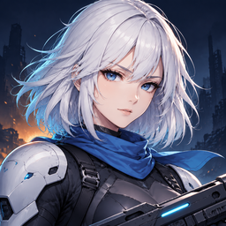

[简体中文](README.md) | **English**

An offline single-player 2D side-scrolling shooter roguelite built with Unity 6000.6.7f1 / C# / URP 2D / Input System. Current build: **8 playable characters, 9 weapons, 10 stages**. Stages 1–5 scroll horizontally, 6–8 climb vertical shafts, stage 9 is a surface swim, and stage 10 takes place underwater. (Earlier downward-scroll designs are kept as historical notes.)

- Code: [GitHub](https://github.com/onyjhgiom/DeltaPact) · [Gitee](https://gitee.com/clt2026/DeltaPact)
- How to play: [HOW_TO_PLAY.md](HOW_TO_PLAY.md)
- Windows x64 demo: [`Releases/MoriEchoes_20261119_233520`](Releases/MoriEchoes_20261119_233520) (SHA-256 and launch instructions included)

## Screenshots

### Key visual

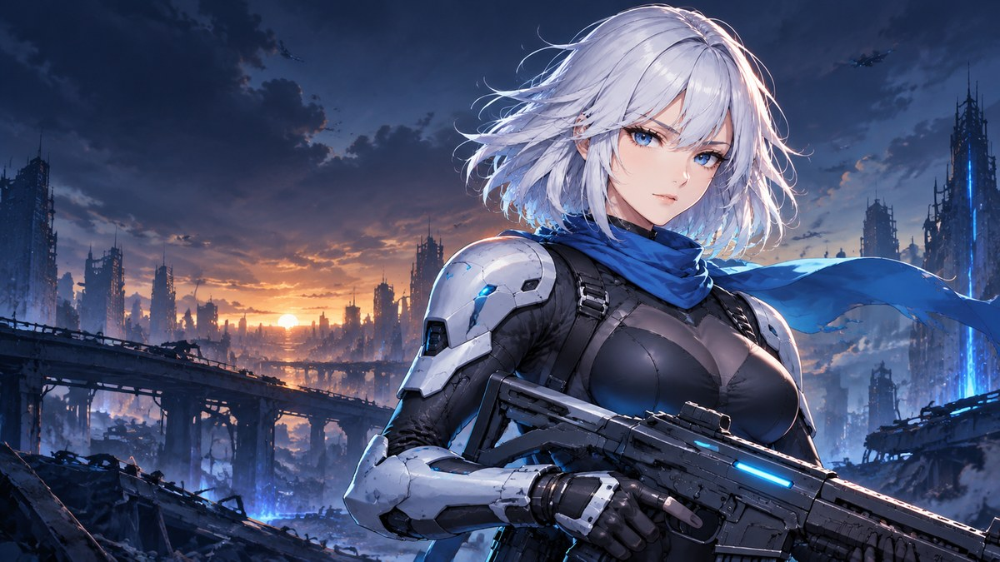

### In-game and characters

| Windows Player captures (ruins / ice tunnel / rift shaft / sunken chapel) | Character art and powered-up forms |
|---|---|
| 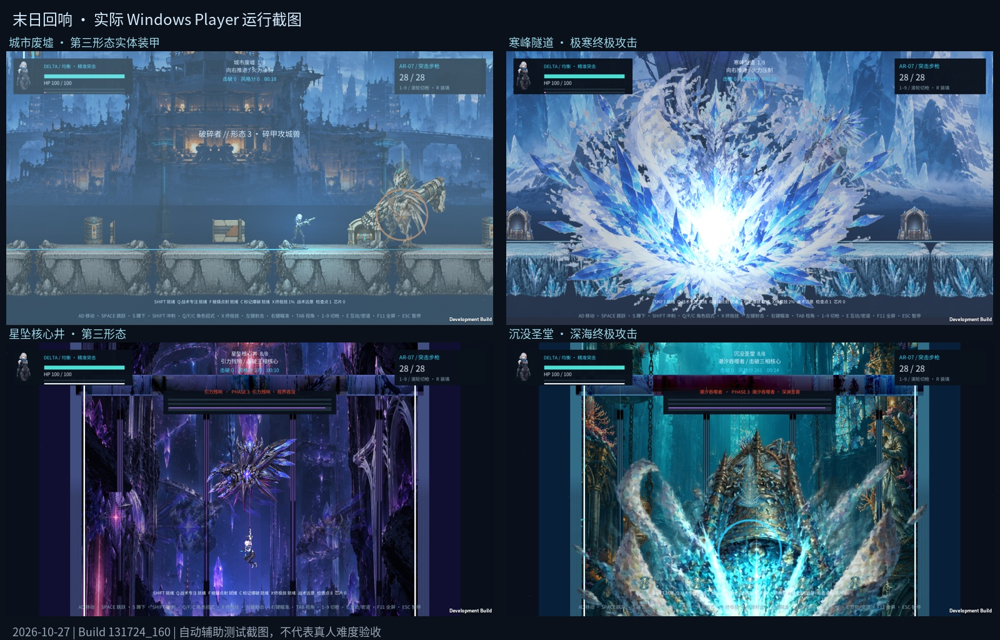 | 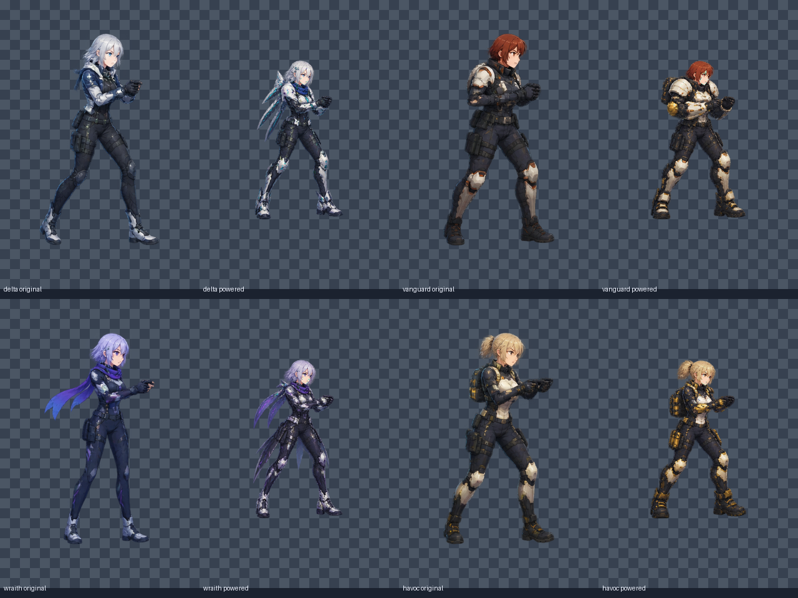 |

| Characters, bosses and weapons overview | Stage-8 boss armor swap and ultimate effects |
|---|---|
| 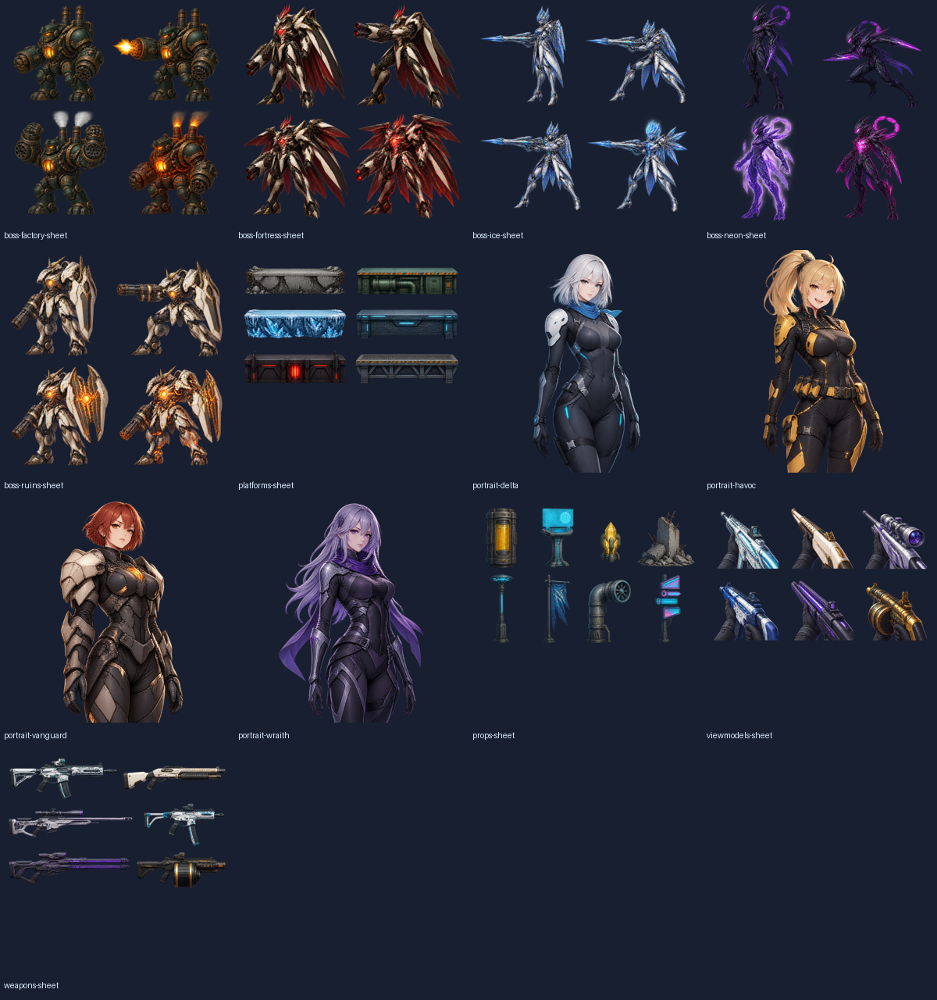 | 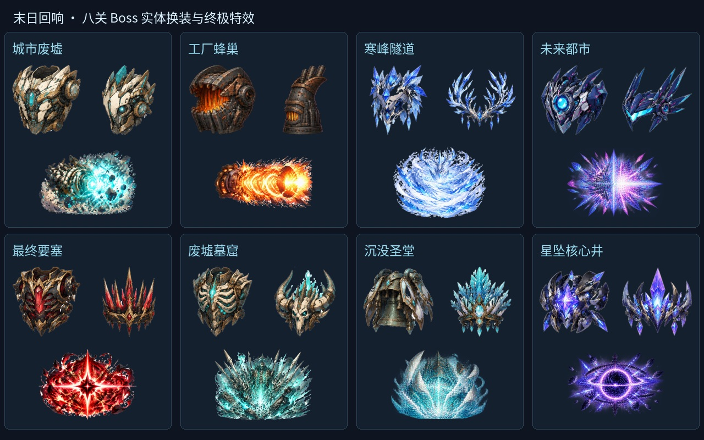 |

### Enemies, skills and new characters

| Enemy types and hit effects | Q/F/C skill VFX (DELTA / VANGUARD / WRAITH / HAVOC) |
|---|---|
| 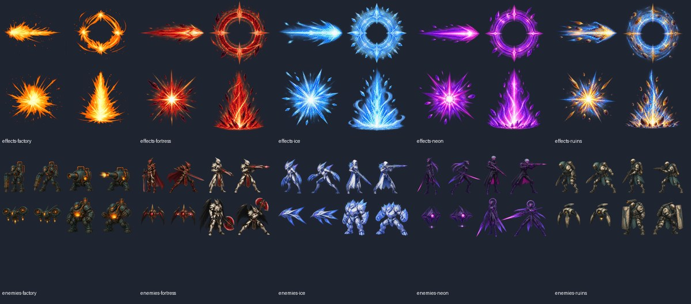 | 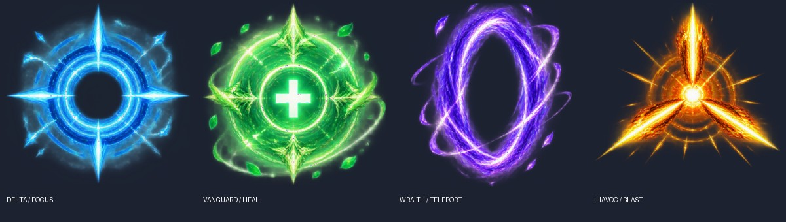 |

Four characters added later: KALT / VEIL / SERA / ROOK.

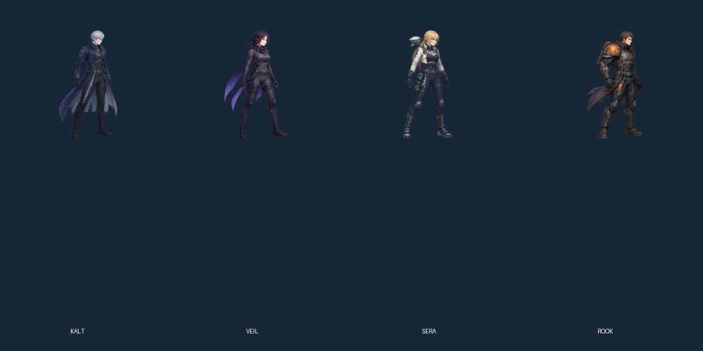

### Stage surfaces and expanded content

Platforms, walls and elevators in the first eight stages use each stage's own generated surface art. Below is a Stage 1–8 Player build comparison (click to enlarge):

  <a href="docs/preview/stage-surfaces-wide.jpg">
    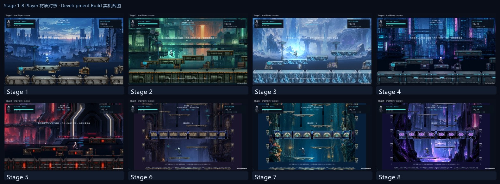
  </a>

Original vertical layout (2×4, higher resolution)

  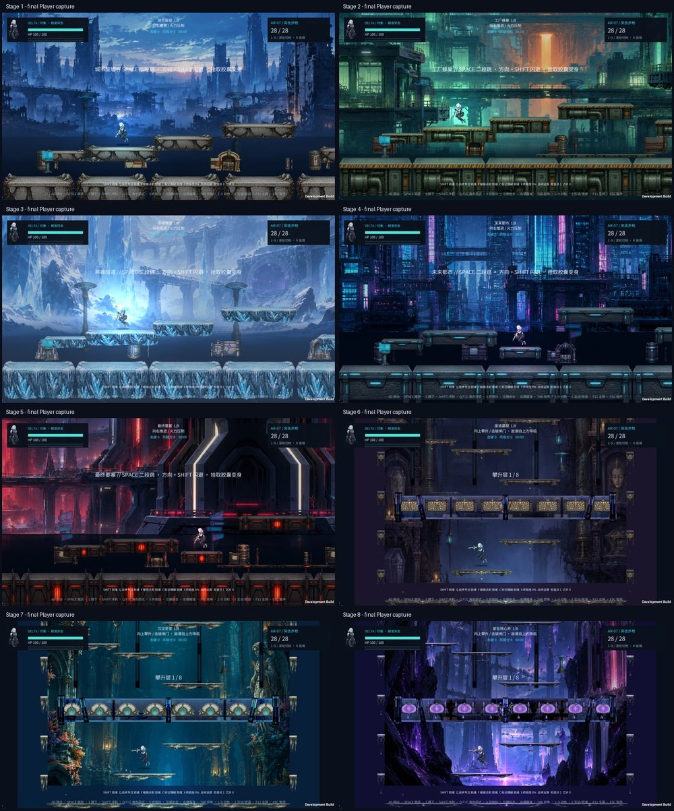

Expand: water-stage art overview (stage 9 surface / stage 10 underwater, split by asset index)

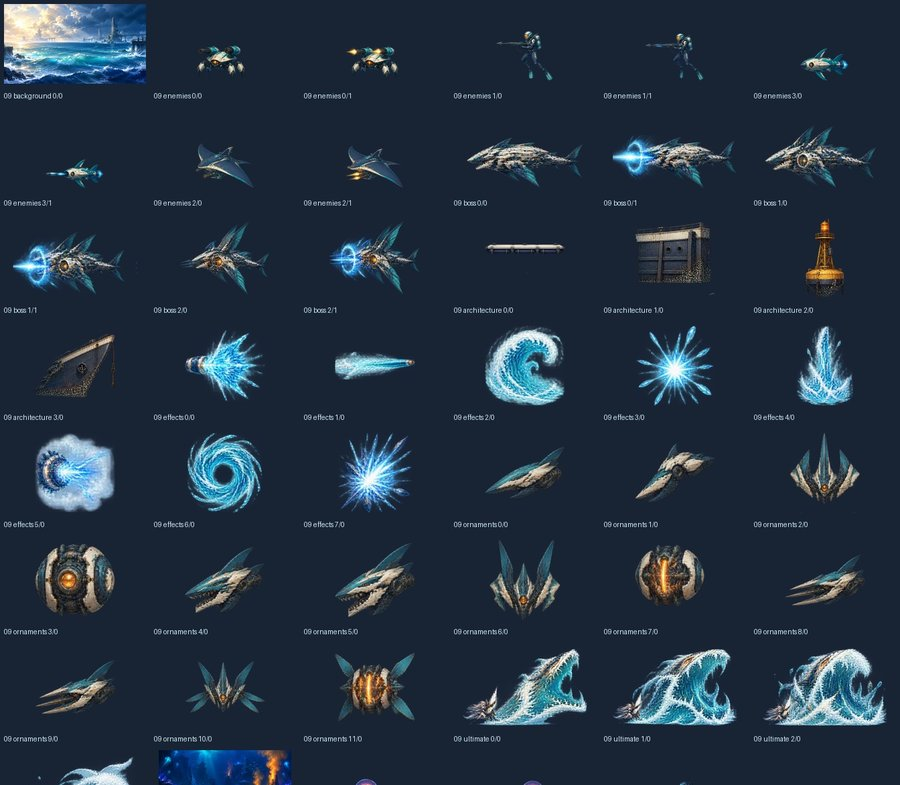

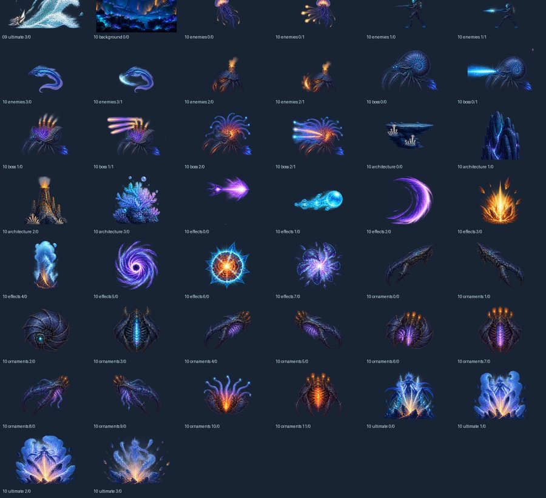

Expand: 3 unique skills per boss across 10 stages (unlocked with three phases)

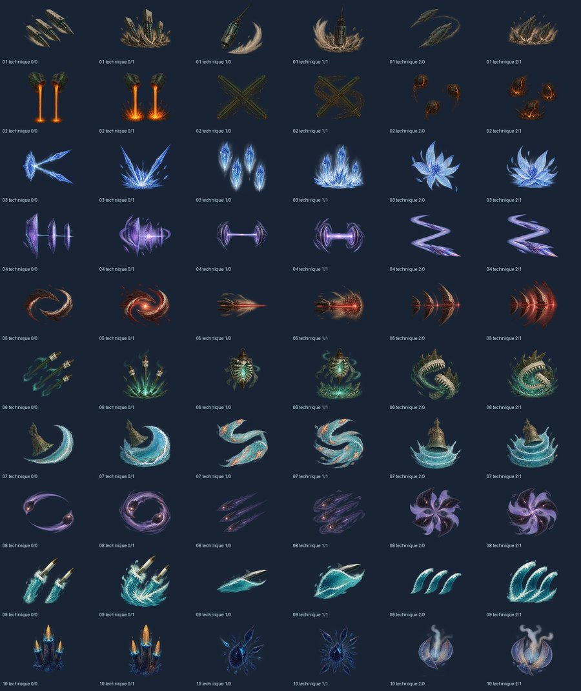

### Image sources

| Preview | Source in project |
|---|---|
| Key visual / icon | `output/imagegen/game-promo-20261120/`, `output/imagegen/game-icon-20261119/` |
| In-game captures | `ArtProduction/boss-ascension-v2/runtime-preview.jpg` |
| Characters and powered-up forms | `ArtProduction/combat-polish-v1/previews/identity-comparison.png` |
| Characters, bosses and weapons | `ArtProduction/arsenal-v2/originals-preview.png` |
| Boss armor swap and ultimates | `ArtProduction/boss-ascension-v2/boss-ascension-preview.jpg` |
| Enemies and hit effects | `ArtProduction/encounter-v3/originals-preview.png` |
| Skill VFX | `ArtProduction/skills-v1/contact-sheet.png` |
| New character art | `ArtProduction/descent-premium-v1/review/new-roster.png` |
| Stage surfaces (wide / vertical) | `Validation/FeedbackTraversal_20261027_Delivery/stage-surfaces-review.jpg`; wide version re-laid out from the same source |
| Water-stage art | `Assets/Art/Production/SwimAnimeV2/review.jpg` |
| Boss skill art | `Assets/Art/Production/BossTechniquesV1/review.jpg` |
| 10 stages and enemies | `AnimeV1/Backgrounds/`, `PremiumV1/Backgrounds/`, `PremiumV1/Enemies/`, `SwimAnimeV2/stage-09|10/` |

> All images come from in-project `ArtProduction/`, `output/imagegen/` and acceptance captures. They are development-build screenshots or generated art, not final commercial artwork. Full asset index: [`Releases/MoriEchoes_素材库_20261120_000432`](Releases/MoriEchoes_素材库_20261120_000432).

## 10 stages and their enemies

Each stage's background and enemies use art already bound in the project, assembled in stage order below; each cell shows the stage enemies on the right, with the stage name and traversal mode below the scene.

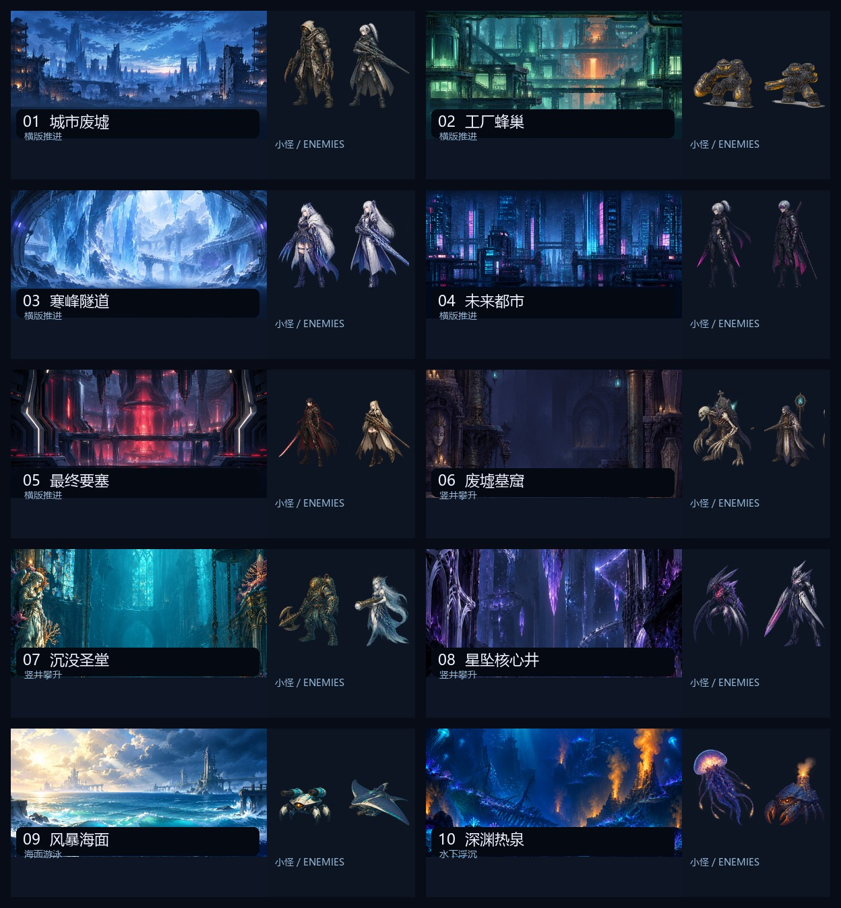

| Stage | Name | Traversal | Background asset | Enemy asset |
|---|---|---|---|---|
| 01 | Ruins | Side-scrolling | `AnimeV1/Backgrounds/ruins.png` | `PremiumV1/Enemies/ruins-*` |
| 02 | Factory Hive | Side-scrolling | `AnimeV1/Backgrounds/factory.png` | `PremiumV1/Enemies/factory-*` |
| 03 | Ice Tunnel | Side-scrolling | `AnimeV1/Backgrounds/ice.png` | `PremiumV1/Enemies/ice-*` |
| 04 | Neo City | Side-scrolling | `AnimeV1/Backgrounds/neon.png` | `PremiumV1/Enemies/neon-*` |
| 05 | Final Fortress | Side-scrolling | `AnimeV1/Backgrounds/fortress.png` | `PremiumV1/Enemies/fortress-*` |
| 06 | Tomb Crypt | Shaft climb | `PremiumV1/Backgrounds/tomb.png` | `PremiumV1/Enemies/tomb-*` |
| 07 | Sunken Chapel | Shaft climb | `PremiumV1/Backgrounds/tide.png` | `PremiumV1/Enemies/tide-*` |
| 08 | Rift Core Shaft | Shaft climb | `PremiumV1/Backgrounds/rift.png` | `PremiumV1/Enemies/rift-*` |
| 09 | Stormy Surface | Surface swimming | `SwimAnimeV2/stage-09/background.png` | `SwimAnimeV2/stage-09/enemies-*` |
| 10 | Abyssal Vents | Underwater | `SwimAnimeV2/stage-10/background.png` | `SwimAnimeV2/stage-10/enemies-*` |

> Paths in the table omit the `Assets/Art/Production/` prefix. Stages 6–8 reuse each stage's main ground surface for the shaft; stages 9–10 use dedicated generated water-stage art.

## Quick start

Double-click `PLAY_MoriEchoes.cmd`. Verified Windows build for this round: `Builds/Windows/MoriEchoes_20261029_173048_021/MoriEchoes.exe`. Close any older running copy first. No new ZIP was produced this round; older builds and share packages remain but do not represent the current version. The Windows x64 offline demo is at `Releases/MoriEchoes_20261119_233520/` — extract it and run `START_GAME.cmd` inside.

## Documentation index

- Controls and launch: [HOW_TO_PLAY.md](HOW_TO_PLAY.md).
- Latest boss vaulting pursuit, high-speed approach, charge tracking and zero-HP-clear implementation, Inspector and tests: `docs/BOSS_PURSUIT_AND_TARGETING_ACCEPTANCE.md`.
- Latest water-stage art, 3 new skills per boss across 10 stages, Inspector and runtime evidence: `docs/SWIM_ART_AND_BOSS_TECHNIQUES_ACCEPTANCE.md`; names, release and visual notes for all 30 skills: `docs/BOSS_TECHNIQUE_DESIGN.md`.
- The main menu now always shows Q/F/C skill and X finisher name, effect, cooldown / energy condition on the selected character card. Paths, Inspector, retest steps and limits: `docs/SWIM_AND_CHARACTER_MENU_ACCEPTANCE.md`.
- Previous round on platform unify, damage tuning, hit feedback, boss red telegraph, mid-stage secret rooms and shaft route: `docs/FEEDBACK_AND_TRAVERSAL_ACCEPTANCE.md`.
- New art, Inspector, difficulty rules, tests and limits: `docs/PREMIUM_ART_ACCEPTANCE.md`.
- Runtime report and file changes: `Validation/BossPursuit_20261029_Delivery/delivery-verification.json`, `file-changes.json` / `.csv`; historical art deliveries remain in their own folders.
- 24 new image originals: `output/imagegen/swim-anime-v1/`, `output/imagegen/boss-techniques-v1/`; 146 bound Sprites and 60 helper normals: `Assets/Art/Production/SwimAnimeV2/`, `Assets/Art/Production/BossTechniquesV1/`. Both folders have previews and SHA-256 manifests; prompts live in the matching `ArtProduction` subfolders.
- 56 image API originals: `output/imagegen/descent-premium-v1`; final 313 Sprites / 234 processed normals: `Assets/Art/Production/PremiumV1`.
- 16 additional boss design originals: `output/imagegen/boss-ascension-v2`; 96 entity parts / 32 ultimate frames / 96 normals: `Assets/Art/Production/BossAscensionV2`. Defense and acceptance: `docs/BOSS_ASCENSION_ACCEPTANCE.md`.
- Prompts and art previews: `ArtProduction/descent-premium-v1/prompts`, `review`.
- Progress: `docs/PROGRESS.md`; current shaft spec: `docs/ASCENT_LEVELS_DESIGN.md`.
- Repo discovery setup (topics, description): `docs/STAR_GROWTH/01-topics-and-description.md`.
- Release publishing guide: `docs/STAR_GROWTH/02-github-release-guide.md`.
- Promotion copy kit: `docs/STAR_GROWTH/03-promotion-kit.md`.

## Gameplay and systems

### Characters and weapons

Playable characters: DELTA, VANGUARD, WRAITH, HAVOC, KALT, VEIL, SERA, ROOK. The original four keep their looks and config; retired character art is retained. Each has Q/F/C skills and an X charged finisher, with 9 weapons including a laser blade. Stages 1–5 have new enemies, hazards, entity modules, guards, later boss phases and attack effects wired to generated art; stages 6–10 and new characters/weapons also have dedicated generated art.

Weapons 1–9: assault rifle, shotgun, precision rifle, SMG, electromagnetic railgun, grenade launcher, laser blade, arc emitter, star-pulse repeater crossbow. A dropped capsule instantly switches the powered-up form and firing mechanic; base per-weapon total projectile damage only rises 8–10%, with actual damage affected by crits, specialization, combos and multi-target hits.

### Damage rules and camera

Enemies stay mobile and bosses keep wide attacks; damage is on the upper-middle scale: single hits from regular enemies / hazards / boss normal skills / ultimates cap at 24% / 28% / 36% / 45% of base health, and at most 55% of the current character's max health; shields and damage reduction apply after the cap. A normal attack cannot one-shot a full-health character, and there is 0.6 s of post-hit protection. Low health can still be lethal, and falling out still counts as a failure. Boss charge-ups show a translucent red landing zone / path; older colored telegraph lines, blocks and countdowns stay hidden. The energy capsule still only raises same-weapon base total projectile damage by 8–10%. Tab switches tactical wide view → third-person near view → first-person weapon foreground aim; all are 2D orthographic.

### Bosses and stages

Bosses are high-defense versions: HP ×1.5, damage reduction 62%, single hit capped at 0.8% of total HP. Three phases swap armor, crest and back gear; normal / ultimate damage multipliers 1.5 / 1.9, area multipliers 1.65 / 1.9, still subject to the player-damage cap above. Bosses keep fighting at low HP; the clear sequence only starts after all main HP is actually brought to zero — the old 15% auto-finish is removed. The death sequence is not interrupted by the level-up screen.

Platforms, walls, elevators and secret passages in stages 1–8 reuse each stage's existing generated ground art: ruined concrete, factory piping, icy rock, city blue alloy, fortress red-black armor, crypt carved stone, chapel blue-gold stone, rift purple structure. The extra short platform in elevator shafts and the permanently open spare door wall are removed. Each of stages 1–8 has exactly one mid-stage secret room, entered by touching the solid door; the main route pauses inside, and you return by defeating the dedicated guard and touching the exit. Stages 9–10 have no hidden passages. All 10 stages are selectable from the menu and real clear progress is still recorded.

### Surface and underwater stages

The surface stage supports shallow dives and leaps out, with 12 groups / 24 floating platforms that can be chained, plus S+Space drop-through. Underwater supports all-direction acceleration and drag, depth formations, oxygen and pressure damage, vent refills and floating capsules. Dedicated backgrounds, grunts, three-phase bosses, entity parts, environment and effects are bound to this round's generated art. Light shafts and bubbles only update near the camera; effects and bullets use bounded pools; a small amount of procedural water / lighting assist remains.

### Skills and pursuit

Each boss across 10 stages has 3 unique skills unlocked with the three phases, woven in after every two original attacks. Each has its own name, release / hit art, trajectory and dodge method. Bosses can vault obstacles to approach the player, telegraphing then dashing in from range at high speed. The red telegraph tracks the player during charge-up; the new skill group locks its landing zone and path about 0.8 s before the first strike, while original side-scroll / shaft / water-stage target strikes keep roughly 0.8 / 0.85 / 0.85 s escape windows. Once activated it does not keep sticking, freezing or hard-snapping to the player. Highlight control is limited to skill cores and edges; actual visuals still need review on your device and preferences.

### Engineering and verification

Project entry: `Assets/Scenes/MainMenu/MainMenu.unity`; GameBootstrap binds `Assets/Settings/MoriEchoesConfig.asset`. Pinned dependencies: Input System 1.20.0, URP 17.6.0, UGUI 2.6.0.

This round's build had 0 errors / 0 warnings, and five groups of Player regression on the same final EXE passed 1767 checks; evidence is in the acceptance docs. Tests use synthetic input plus invincibility / damage / position assists; the 30-skill suite sets phase and cast counters to cover all skills, plus boss vaulting pursuit, actual damage and post-lock dodging across all 10 stages, and low-HP no-auto-finish, the final hit and XP interference during the death sequence. Manual difficulty tuning, long-form gamepad testing, Editor Play Mode and final commercial art sign-off are not verified; cross-machine testing was cancelled at the user's request. Historical delivery reports describe only their own builds.

## License

[Mulan Permissive Software License, Version 2 (MulanPSL-2.0)](LICENSE).
